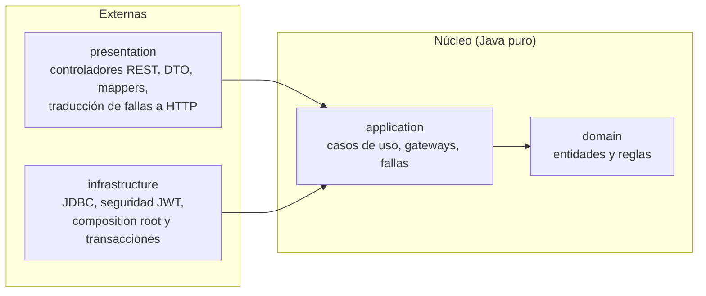

# Arquitectura del backend Moliselva: Clean Architecture

Actualizada el 16 de noviembre de 2026. Alcance: PO-01 (recepción de maíz, proveedores y kardex de maíz), producción por lote y pedidos y despachos.

## 1. Por qué Clean Architecture

Moliselva tiene muchas reglas de negocio, como los rangos de humedad, la merma de limpieza, las decisiones del jefe de planta y los permisos por rol, y hoy solo cubre uno de sus procesos. Los procesos siguientes se construirán como microservicios aparte. Clean Architecture da una estructura que se repite igual en cada servicio:

- Las reglas viven en un núcleo de Java puro (`domain` y `application`), sin Spring ni SQL. Se prueban en milisegundos y no cambian si cambia el framework, la base de datos o el cliente.
- Cada caso de uso es una clase con un nombre de negocio (`RegistrarRecepcion`, `ExportarKardexMaiz`), lo que hace explícito qué hace el sistema.
- Una prueba automática (`ArquitecturaLimpiaTest`) impide que alguien rompa la regla de dependencias.

## 2. Capas



| Capa | Paquete | Puede depender de | No puede depender de |
|---|---|---|---|
| Dominio | `pe.edu.upeu.moliselva.domain` | Solo Java | Spring, jakarta, swagger, otras capas, módulos legados |
| Aplicación | `...application` | `domain` | Spring, jakarta, swagger, `presentation`, `infrastructure`, módulos legados |
| Presentación | `...presentation` | `application`, `domain`, Spring Web y Security, validación | `infrastructure`, `application..gateway`, JDBC |
| Infraestructura | `...infrastructure` | `application`, `domain`, Spring, JDBC | `presentation` |

La regla de dependencias es: **las flechas siempre apuntan al núcleo**. `application` define interfaces (casos de uso de entrada y gateways de salida) y las capas externas las usan o las implementan.

### Estructura de carpetas

```
domain/
  recepcion/    Recepcion, RecepcionDatos, EstadoRecepcion, DecisionRecepcion, RecepcionBloqueo, RecepcionPolicy
  proveedor/    Proveedor, ProveedorDatos (normaliza razón social, documento y teléfono)
  inventario/   MovimientoKardex, KardexCsv (formato para Excel)
  produccion/   Lote, LoteInsumo, DatosLote, DatosInsumo, EstadoLote, LotePolicy (500 o 1000 kg, estados editables)
  ventas/       Pedido, Despacho, sus detalles y estados, TipoEntrega, DespachoPolicy (qué pedido admite despacho, destino del reparto)
application/
  shared/       Actor, ActorActual, BitacoraGateway, FallaNegocio, Permisos
  recepcion/    usecase/ (interfaces *UseCase + interactores), gateway/
  proveedor/    usecase/, gateway/
  inventario/   usecase/, gateway/
  produccion/   usecase/ (planificar, insumos, estado, finalizar, consultar; LoteChecks), gateway/
  ventas/       usecase/ (pedidos, detalles, despachos, confirmar, consultar; VentaChecks), gateway/
presentation/rest/
  recepcion/ proveedor/ inventario/ produccion/ ventas/   controladores, dto/, mapper/
  error/        ManejadorFallasNegocio
infrastructure/
  persistence/jdbc/{recepcion,proveedor,inventario,bitacora}/
  security/     JwtActorActual
  config/       Transacciones y los composition roots Po01UseCaseConfig, ProduccionUseCaseConfig y VentasUseCaseConfig
```

## 3. Recorrido de `POST /api/recepciones`

1. **presentation**: `RecepcionController.crear` recibe `RecepcionDto.Crear`, que valida con `@Valid`. `@PreAuthorize` exige OPERARIO o JEFE_PLANTA. `RecepcionMapper.aDatos` lo convierte en `RecepcionDatos` (dominio) y `ActorActual.obtener()` entrega el usuario del token, nunca del cuerpo.
2. **infrastructure/config**: el bean `RegistrarRecepcionUseCase` que recibió el controlador es un proxy creado en `Po01UseCaseConfig` con `Transacciones.envolver`. Abre una transacción de escritura y llama al interactor.
3. **application**: `RegistrarRecepcion` comprueba el rol y que el proveedor esté activo (`ProveedorActivoGateway`), obtiene el maíz (`EntradaKardexGateway`), evalúa las reglas, inserta con `id_registra` (`RecepcionGateway`), crea la entrada al kardex si quedó ACEPTADA y escribe la bitácora (`BitacoraGateway`).
4. **domain**: `RecepcionPolicy.evaluar` calcula el peso neto y la entrada al kardex, y decide entre ACEPTADA (hasta 14.5 %), PENDIENTE (de 14.5 % a 15 %) y RECHAZADA (más de 15 %).
5. **infrastructure/persistence**: `JdbcRecepcionGateway`, `JdbcProveedorGateway`, `JdbcKardexMaizGateway` y `JdbcBitacoraGateway` ejecutan el SQL. La transacción hace commit; ante cualquier falla se revierte todo.
6. **presentation**: `RecepcionMapper.aRespuesta` produce `RecepcionDto.Respuesta`. Si el caso de uso lanzó una `FallaNegocio`, `ManejadorFallasNegocio` responde `{codigo, mensaje}` con 403, 400, 404 o 409 según su tipo.

## 4. Cómo agregar un caso de uso

1. Si hay reglas nuevas, agregarlas en `domain/<modulo>` como métodos puros y probarlas sin Spring.
2. En `application/<modulo>/usecase`, crear la interfaz `HacerAlgoUseCase` y el interactor `HacerAlgo`, sin anotaciones. Comprobar permisos con `Permisos.exigir` y lanzar fallas que extiendan `FallaNegocio`.
3. Si necesita datos, declarar la interfaz en `application/<modulo>/gateway` e implementarla en `infrastructure/persistence/jdbc/<modulo>`.
4. Registrar el bean en el composition root del módulo (`infrastructure/config`) con `tx.envolver(Interfaz.class, new Interactor(...))`. Si el nombre de la interfaz empieza con `Consultar`, la transacción es de solo lectura; si no, es de escritura y cualquier excepción la revierte (igual que `@Transactional`). `TransaccionesTest` comprueba esa convención.
5. Exponerlo en `presentation/rest/<modulo>`: controlador, DTO, mapper y `@PreAuthorize`. JSON en camelCase. Obtener el usuario con `ActorActual`, nunca del cuerpo. En recepción, proveedores y kardex la conversión de entrada está en el mapper; en producción y ventas, los DTO de entrada conservan su método `toDatos()`, que también es código de presentación. Al tocar esos DTO conviene pasar esa conversión a su mapper.
6. Escribir la prueba unitaria del interactor con gateways simulados. `ArquitecturaLimpiaTest` debe seguir en verde.

## 5. Procesos futuros como microservicios

Cada proceso nuevo (por ejemplo, la producción por lote) se crea como un servicio Spring Boot propio con **las mismas cuatro capas y la misma prueba ArchUnit**. Se puede partir de la estructura de este repositorio y copiar `application/shared` (actor, fallas, permisos, bitácora). La comunicación entre servicios se define como un gateway en `application` y su cliente HTTP o de mensajería en `infrastructure`, de modo que el núcleo no cambia.

## 6. Lo que falta migrar

| Módulo | Estilo actual | Nota |
|---|---|---|
| `inventario` (stock general, movimientos, ajustes) | Controlador → servicio → repositorio | El kardex de maíz ya está migrado |
| `maestros`, `operaciones`, `auth` | Controlador → servicio → repositorio | `ApiException` (HTTP) dentro de los servicios |
| `comun` | `SecurityConfig`, `ApiErrors`, bitácora web | Seguridad y errores generales pasarán a `infrastructure` y `presentation` |

Los gateways JDBC de producción y ventas todavía usan `operaciones.OperacionRepository` (SQL compartido con fórmulas) y `comun.BitacoraService`. Eso está permitido en `infrastructure` y desaparece cuando se migren esos módulos.
