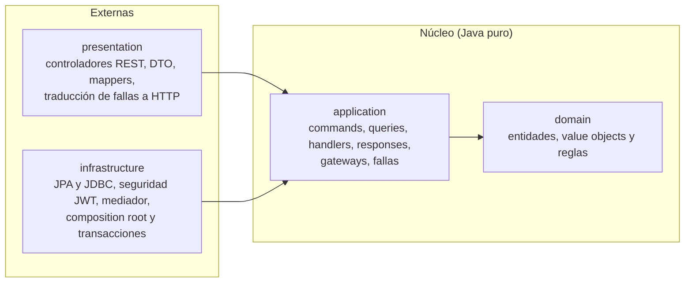

# Arquitectura del backend Moliselva: Clean Architecture

Actualizada el 16 de noviembre de 2026. Alcance: **todo el backend**: PO-01 (recepción de maíz, proveedores y kardex de maíz), producción por lote, pedidos y despachos, autenticación y usuarios, clientes, insumos y productos, fórmulas, inventario general y bitácora.

El proceso principal, la recepción de maíz y su kardex (PO-01), usa además **CQRS con mediador**, entidades con comportamiento, value objects y JPA para escribir (sección 3). El resto de módulos usa casos de uso clásicos dentro de las mismas cuatro capas.

## 1. Por qué Clean Architecture

Moliselva tiene muchas reglas de negocio, como los rangos de humedad, la merma de limpieza, las decisiones del jefe de planta y los permisos por rol, y hoy solo cubre uno de sus procesos. Los procesos siguientes se construirán como microservicios aparte. Clean Architecture da una estructura que se repite igual en cada servicio:

- Las reglas viven en un núcleo de Java puro (`domain` y `application`), sin Spring ni SQL. Se prueban en milisegundos y no cambian si cambia el framework, la base de datos o el cliente.
- Cada caso de uso tiene un nombre de negocio (`RegistrarRecepcion`, `ExportarKardexMaiz`), lo que hace explícito qué hace el sistema.
- Una prueba automática (`ArquitecturaLimpiaTest`) impide que alguien rompa la regla de dependencias.

## 2. Capas



| Capa | Paquete | Puede depender de | No puede depender de |
|---|---|---|---|
| Dominio | `pe.edu.upeu.moliselva.domain` | Solo Java | Spring, jakarta (incluido JPA), Hibernate, swagger, otras capas |
| Aplicación | `...application` | `domain` | Spring, jakarta, Hibernate, swagger, `presentation`, `infrastructure` |
| Presentación | `...presentation` | `application`, `domain`, Spring Web y Security, validación | `infrastructure`, `application..gateway`, handlers, JDBC |
| Infraestructura | `...infrastructure` | `application`, `domain`, Spring, JPA, JDBC | `presentation` |

La regla de dependencias es: **las flechas siempre apuntan al núcleo**. Además, toda clase vive en una de las cuatro capas; en la raíz del paquete solo está `MoliselvaApplication`. `application` define interfaces (casos de uso de entrada y gateways de salida) y las capas externas las usan o las implementan.

### Estructura de carpetas

```
domain/
  shared/       value objects comunes: Kilogramos, Motivo
  recepcion/    entidad Recepcion; value objects PesajeMaiz y PorcentajeHumedad; EstadoRecepcion,
                DecisionRecepcion; RecepcionInvalida (regla incumplida)
  proveedor/    Proveedor, ProveedorDatos (normaliza razón social, documento y teléfono)
  produccion/   Lote, LoteInsumo, DatosLote, DatosInsumo, EstadoLote, LotePolicy (500 o 1000 kg, estados editables)
  ventas/       Pedido, Despacho, sus detalles y estados, TipoEntrega, DespachoPolicy (qué pedido admite despacho, destino del reparto)
  auth/         Usuario, CuentaUsuario (con hash), UsuarioDatos, Rol
  maestros/     Cliente, Insumo, Producto y sus *Datos (normalización y valores por defecto), Maestros (insumo Maíz protegido)
  formulas/     Formula, FormulaDetalle, FormulaDatos (vigente por defecto)
  inventario/   ItemStock, MovimientoInventario, AjusteInventario (un solo insumo o producto)
  reglas/       BusinessRules (fachada de reglas de cálculo)
application/
  shared/       Actor, ActorActual, BitacoraGateway, FallaNegocio, FallaAplicacion, Permisos
                cqrs/ Command, Query, CommandHandler, QueryHandler, Mediador
  recepcion/    registrar/ corregir/ decidir/ eliminar/   (XxxCommand + XxxHandler)
                listar/ obtener/                          (XxxQuery + XxxHandler)
                RecepcionResponse, RecepcionFailure, ReglasRecepcion
                gateway/ RecepcionGateway (escritura), RecepcionConsultaGateway (lectura),
                         EntradaKardexGateway, ProveedorActivoGateway
  inventario/   kardex/ listar/ stock/ (queries) y exportar/ (command, CSV para Excel),
                        MovimientoKardexResponse, MaizNoConfigurado
                usecase/ ConsultarInventario y RegistrarAjuste; gateway/
  proveedor/    usecase/, gateway/
  produccion/   usecase/ (planificar, insumos, estado, finalizar, consultar; LoteChecks), gateway/
  ventas/       usecase/ (pedidos, detalles, despachos, confirmar, consultar; VentaChecks), gateway/
  auth/         usecase/ (IniciarSesion, ConsultarUsuarios, GestionarUsuarios, ConsultarRoles, ActivarUsuariosDemo),
                gateway/ (UsuarioGateway, RolGateway, CifradorClaves, EmisorToken)
  maestros/     usecase/ (ConsultarMaestros, GestionarClientes, GestionarInsumos, GestionarProductos), gateway/
  formulas/     usecase/ (ConsultarFormulas, GestionarFormulas, GestionarDetallesFormula; FormulaChecks), gateway/
  bitacora/     usecase/ConsultarBitacora, gateway/BitacoraConsultaGateway
presentation/rest/
  recepcion/ proveedor/ inventario/ produccion/ ventas/ auth/ maestros/ formulas/ bitacora/   controladores, dto/, mapper/
  error/        ManejadorFallasNegocio (fallas de negocio) y ManejadorErroresGenerales (validación, JSON inválido, 500)
  config/       OpenApiConfig
infrastructure/
  cqrs/         MediadorSpring (busca el handler por tipo y abre la transacción)
  persistence/jpa/{recepcion,inventario}/   entidades JPA, repositorios Spring Data, mappers y gateways de escritura
  persistence/jdbc/{recepcion,proveedor,inventario,bitacora,produccion,ventas,auth,maestros,formulas,shared}/
  security/     SecurityConfig, JwtActorActual, JwtEmisorToken, BCryptCifradorClaves
  config/       Transacciones, UsuariosDemoInicializador y los composition roots Po01, Produccion, Ventas, Auth y Catalogos
```

## 3. CQRS con mediador, entidades y value objects

### 3.1 Un caso de uso es un conjunto, no una clase

Equivale a MediatR en .NET. Cada caso de uso tiene su carpeta con tres piezas:

| Pieza | En .NET (MediatR) | Aquí | Ejemplo |
|---|---|---|---|
| Petición de escritura | `IRequest<R>` (command) | `record XxxCommand implements Command<R>` | `RegistrarRecepcionCommand` |
| Petición de lectura | `IRequest<R>` (query) | `record XxxQuery implements Query<R>` | `ListarRecepcionesQuery` |
| Handler | `IRequestHandler<TReq,R>` | `class XxxHandler implements CommandHandler<C,R>` o `QueryHandler<Q,R>` | `RegistrarRecepcionHandler` |
| Respuesta | `XxxResponse` | `record XxxResponse` (si varias operaciones devuelven la misma vista, la comparten en el módulo) | `RecepcionResponse` |
| Mediador | `IMediator.Send(...)` | `Mediador.enviar(...)` | `mediador.enviar(new ObtenerRecepcionQuery(11))` |
| Pipeline behavior | `IPipelineBehavior` | `MediadorSpring` abre la transacción: escritura para commands, solo lectura para queries | |
| Registro | `services.AddMediatR(...)` | `@Bean` de cada handler en el composition root; `MediadorSpring` los indexa por tipo | `Po01UseCaseConfig` |

En Java no se usa el prefijo `I`: la interfaz es `CommandHandler` y la implementación es `RegistrarRecepcionHandler`. El controlador solo conoce `Mediador`; nunca un handler ni un gateway. Si un command no tiene handler o tiene dos, `ArquitecturaLimpiaTest` falla y la aplicación no arranca. Exportar el kardex es un **command** aunque no cambie datos de negocio, porque deja la exportación en la bitácora.

### 3.2 Entidades, value objects y enums

- **Entidad** (`class`, con id): tiene identidad y ciclo de vida, y solo cambia a través de sus métodos. Dos instancias con el mismo id son la misma entidad aunque cambien sus datos. Ejemplo: `Recepcion`, con `registrar`, `decidir`, `corregir`, `verificarEditable` e `ingresaAlKardex`. Una recepción aceptada o decidida por el jefe no se puede corregir ni eliminar, y solo una PENDIENTE se puede decidir, una vez.
- **Value object** (`record`, **sin id**): se identifica por su valor y se valida al crearse, así que si existe es válido. Ejemplos:
  - `PesajeMaiz` (bruto, tara, sacos y merma): calcula el neto con 2 decimales y la entrada al kardex con 3.
  - `PorcentajeHumedad`: de 0 a 100; decide ACEPTADA (hasta 14.5 %), PENDIENTE (hasta 15 %) o RECHAZADA.
  - `Kilogramos` y `Motivo`.

  Los decimales se comparan por valor: 890.0 kg y 890.00 kg son iguales.
- **Enum**: valores cerrados, como `EstadoRecepcion` y `DecisionRecepcion`.

Las reglas incumplidas del dominio lanzan `RecepcionInvalida` con su regla. El handler la traduce a `RecepcionFailure` con el mismo código y mensaje, que la API responde como siempre.

### 3.3 Persistencia: JPA escribe, JDBC lee

Es el mismo patrón que EF Core para escribir y Dapper para leer.

- **Commands con JPA (Hibernate):**
  - `JpaRecepcionGateway` carga la recepción con bloqueo de fila (`@Lock(PESSIMISTIC_WRITE)`), la convierte en la entidad del dominio, y después de que el handler aplica el comportamiento guarda los cambios.
  - La entidad JPA (`RecepcionJpa`, `@Entity`) vive en `infrastructure` y solo refleja columnas. El dominio no tiene anotaciones de JPA y `RecepcionJpaMapper` convierte entre ambas.
  - La entrada al kardex se inserta con `MovimientoInventarioJpa` (`@Immutable`), porque el kardex nunca se actualiza.
- **Queries con JDBC:**
  - `JdbcRecepcionConsulta` y `JdbcKardexMaizGateway` ejecutan el SQL con sus `JOIN` (proveedor, usuarios, vistas del kardex) y lo mapean directo a la Response, sin pasar por la entidad.
- **Esquema:**
  - Lo crean los scripts de `db/init`. Hibernate usa `ddl-auto: validate`: solo comprueba el mapeo al arrancar y nunca crea ni altera tablas.
  - `peso_neto_kg` (columna generada) y `fecha_hora` (valor por defecto) los calcula PostgreSQL.
- **Una transacción:**
  - JPA, JDBC (bitácora, consultas) y los triggers de la base comparten la transacción del command.
  - Cada escritura JPA hace `flush`, para que el SQL siga el orden del caso de uso.
  - Si el trigger de stock rechaza un movimiento, se revierte todo.

### 3.4 Qué módulos usan CQRS

| Módulo | Estilo |
|---|---|
| Recepción de maíz y kardex de maíz (PO-01) | CQRS + mediador + entidades + value objects + JPA/JDBC |
| Producción por lote, pedidos y despachos, proveedores, clientes, insumos, productos, fórmulas, usuarios y roles, login, inventario general y bitácora | Casos de uso clásicos, por decisión: interfaz de caso de uso + interactor + JDBC, envuelto por `Transacciones`. Cumplen la misma regla de dependencias. Si un proceso crece en reglas, se puede pasar a CQRS siguiendo el modelo de recepción (sección 5.1) |

## 4. Recorrido de `POST /api/recepciones`

1. **presentation**:
   - `RecepcionController.crear` recibe `RecepcionDto.Crear`, que valida con `@Valid`, y `@PreAuthorize` exige OPERARIO o JEFE_PLANTA.
   - `RecepcionMapper.aRegistrar` arma `RegistrarRecepcionCommand` con el usuario del token (`ActorActual`, nunca del cuerpo).
   - El controlador llama `mediador.enviar(command)`.
2. **infrastructure/cqrs**: `MediadorSpring` busca el handler registrado para `RegistrarRecepcionCommand`, abre una transacción de escritura y lo ejecuta.
3. **application**: `RegistrarRecepcionHandler`:
   - comprueba el rol y que el proveedor esté activo, y obtiene el id del maíz;
   - crea los value objects y la entidad (`Recepcion.registrar`);
   - la guarda (`RecepcionGateway`);
   - si quedó ACEPTADA, registra la entrada al kardex (`EntradaKardexGateway`);
   - escribe la bitácora;
   - lee la `RecepcionResponse` (`RecepcionConsultaGateway`).
4. **domain**: `PesajeMaiz` valida los pesos y calcula el neto y la entrada al kardex. `PorcentajeHumedad` decide el estado inicial.
5. **infrastructure/persistence**:
   - JPA inserta la recepción (`JpaRecepcionGateway`) y el movimiento (`JpaEntradaKardexGateway`);
   - JDBC escribe la bitácora y lee la respuesta (`JdbcRecepcionConsulta`).
   - La transacción hace commit; ante cualquier falla se revierte todo.
6. **presentation**:
   - `RecepcionMapper.aRespuesta` produce `RecepcionDto.Respuesta`, con el mismo JSON de siempre.
   - Una `FallaNegocio` se responde `{codigo, mensaje}` con 403, 400, 404 o 409 (`ManejadorFallasNegocio`).

## 5. Cómo agregar un caso de uso

### 5.1 En un módulo con CQRS (recepción y kardex de maíz)

1. Crear la carpeta `application/<modulo>/<caso>/` con:
   - `XxxCommand` (o `XxxQuery`): un `record` con la entrada y el `Actor`, si importa quién lo hace;
   - `XxxHandler`: implementa `CommandHandler<XxxCommand, R>` o `QueryHandler<XxxQuery, R>`, sin anotaciones;
   - la Response, si es nueva.
2. Poner las reglas en la entidad o en un value object de `domain/<modulo>` y probarlas sin Spring.
3. **Escritura:** un método en el gateway del agregado, implementado con JPA. **Lectura:** el SQL en el gateway de consulta, implementado con JDBC.
4. Registrar el handler como `@Bean` en el composition root, devolviendo la clase concreta. El mediador lo encuentra solo.
5. En el controlador: el mapper arma el command, se llama `mediador.enviar(...)` y la Response se convierte al DTO JSON.

### 5.2 En un módulo simple

1. Si hay reglas nuevas, agregarlas en `domain/<modulo>` como métodos puros y probarlas sin Spring.
2. En `application/<modulo>/usecase`, crear la interfaz `HacerAlgoUseCase` y el interactor `HacerAlgo`, sin anotaciones. Comprobar permisos con `Permisos.exigir` y lanzar fallas que extiendan `FallaNegocio`.
3. Si necesita datos, declarar la interfaz en `application/<modulo>/gateway` e implementarla en `infrastructure/persistence/jdbc/<modulo>`.
4. Registrar el bean en el composition root del módulo (`infrastructure/config`) con `tx.envolver(Interfaz.class, new Interactor(...))`. Si el nombre de la interfaz empieza con `Consultar`, la transacción es de solo lectura; si no, es de escritura y cualquier excepción la revierte (igual que `@Transactional`). `TransaccionesTest` comprueba esa convención.
5. Exponerlo en `presentation/rest/<modulo>`: controlador, DTO, mapper y `@PreAuthorize`. JSON en camelCase. Obtener el usuario con `ActorActual`, nunca del cuerpo. En recepción, proveedores y kardex la conversión de entrada está en el mapper; en producción y ventas, los DTO de entrada conservan su método `toDatos()`, que también es código de presentación. Al tocar esos DTO conviene pasar esa conversión a su mapper.
6. Escribir la prueba unitaria del interactor con gateways simulados. `ArquitecturaLimpiaTest` debe seguir en verde.

## 6. Procesos futuros como microservicios

Cada proceso nuevo (por ejemplo, la producción por lote) se crea como un servicio Spring Boot propio con **las mismas cuatro capas y la misma prueba ArchUnit**. Se puede partir de la estructura de este repositorio y copiar `application/shared` (actor, fallas, permisos, bitácora y `cqrs`) e `infrastructure/cqrs/MediadorSpring`. La comunicación entre servicios se define como un gateway en `application` y su cliente HTTP o de mensajería en `infrastructure`, de modo que el núcleo no cambia.

## 7. Estado de la migración

La migración terminó el 16 de noviembre de 2026: no quedan módulos fuera de las cuatro capas, y `ArquitecturaLimpiaTest` lo exige. Se verificó que el comportamiento no cambió:

- La lógica de producción y ventas es idéntica al original línea por línea (51 de 51 archivos).
- El contrato OpenAPI no tiene diferencias (48 rutas, 33 esquemas).
- 65 respuestas reales comparadas contra la versión anterior, sobre la misma base, tienen el mismo estado y el mismo JSON.
- Los humos de PO-01 y del CRUD completo pasan con base nueva.

El detalle está en `evidencias/clean-architecture-2026-11-16.md`.

El 16 de noviembre, la recepción y el kardex de maíz pasaron a Command/Query + Handler + Response con mediador, entidades y value objects, y JPA para escribir. Se verificó así:
- las mismas pruebas de antes y otras nuevas: 213 en total;
- OpenAPI sin diferencias;
- humos con base nueva: 51 y 116 OK;
- la versión anterior y la nueva, sobre la misma base: 65/65 lecturas y 25/25 escrituras con el mismo resultado.

El detalle está en `evidencias/cqrs-jpa-2026-11-16.md`.

Notas para seguir:
- Los DTO de entrada de producción y ventas conservan `toDatos()`. Al tocarlos, conviene pasar esa conversión a su mapper.
- Los gateways JDBC de producción y ventas usan `infrastructure/persistence/jdbc/shared/JdbcFilas`, que lee filas como mapas.
- La bitácora y las fórmulas responden mapas para conservar exactamente su JSON publicado. La bitácora mantiene los nombres de columna (`id_bitacora`, `fecha_hora`...).
- Los errores `{codigo, mensaje}` se arman con `Map.of`, que no garantiza el orden de las claves (ya era así antes). Si alguna vez se necesita un orden fijo, basta con usar un `LinkedHashMap` en los manejadores.
