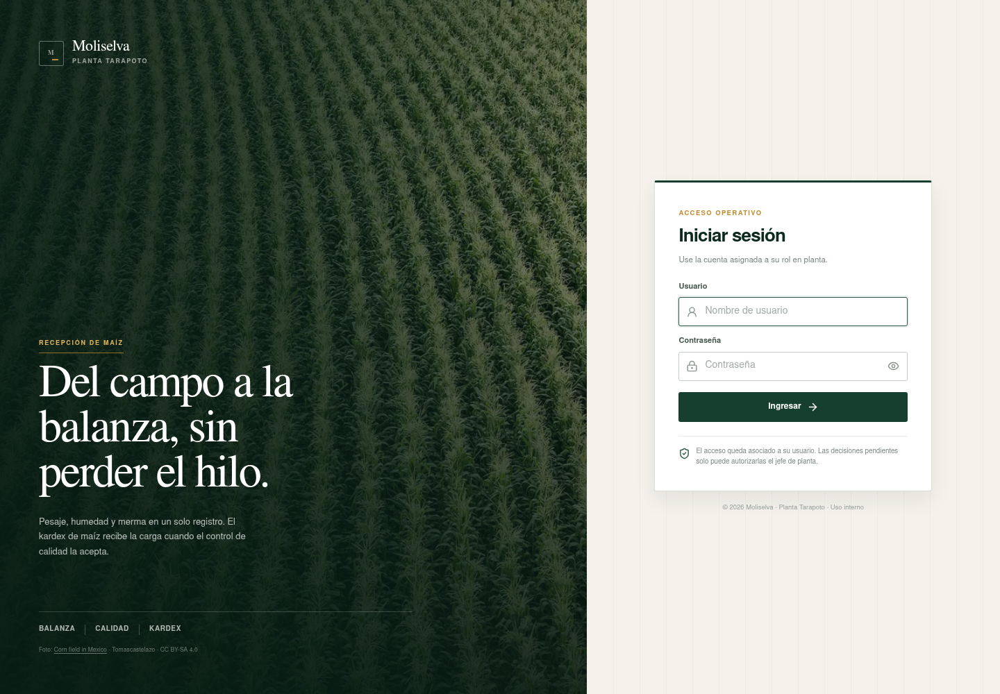
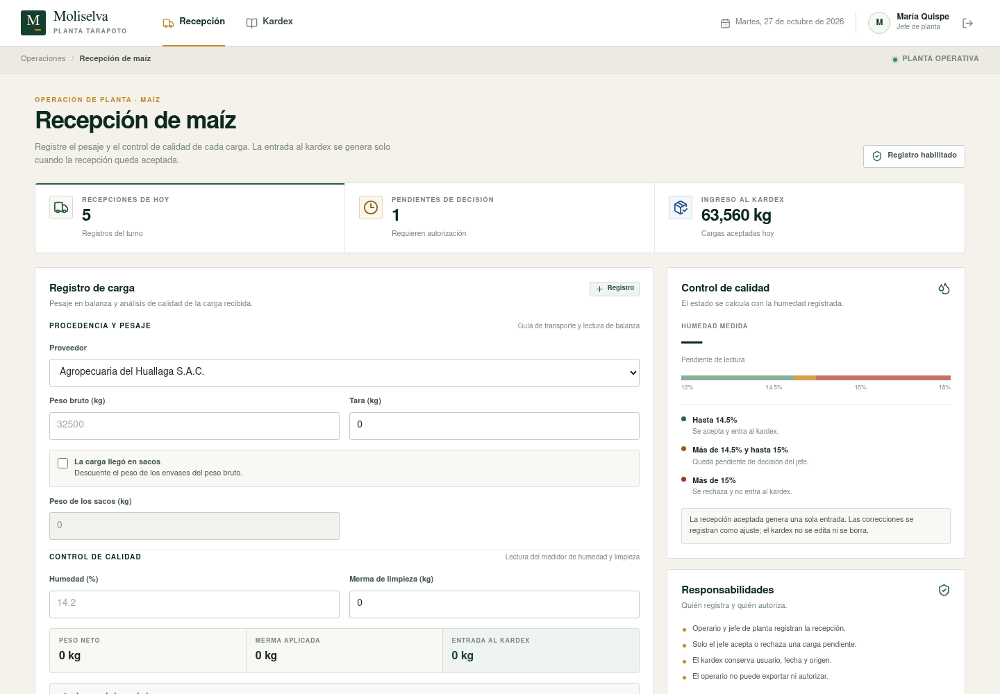
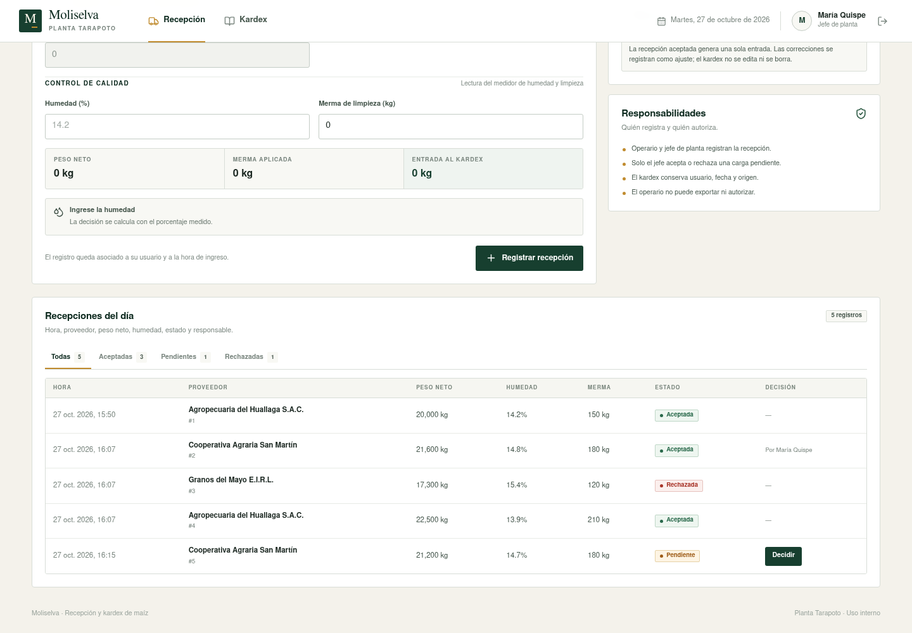
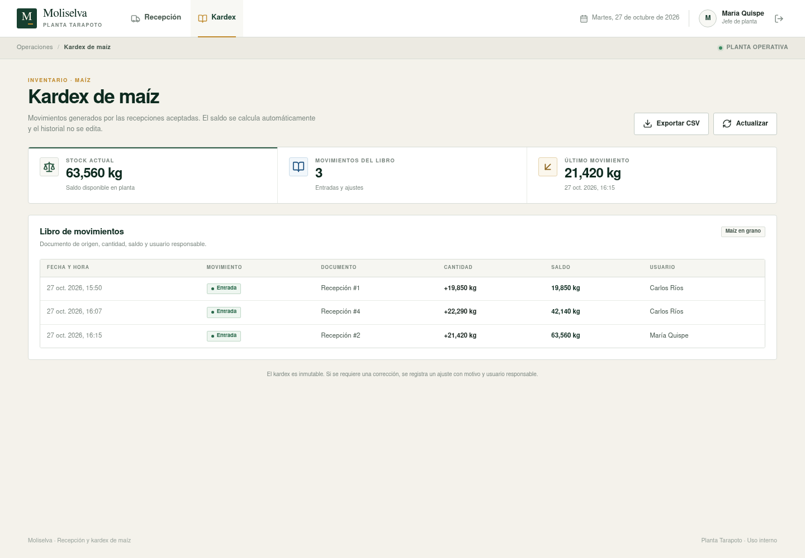
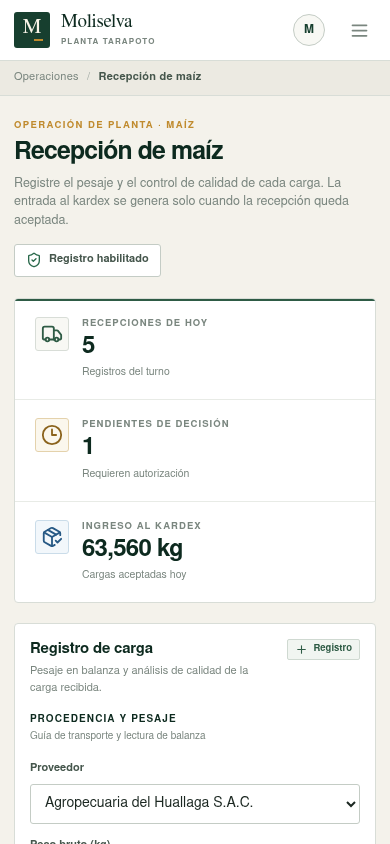
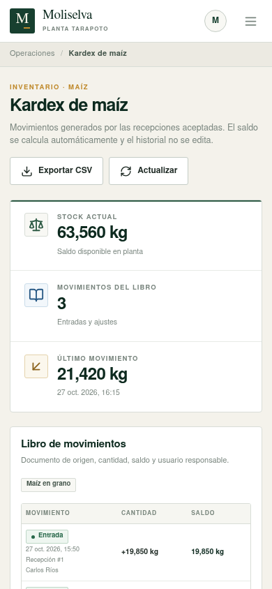
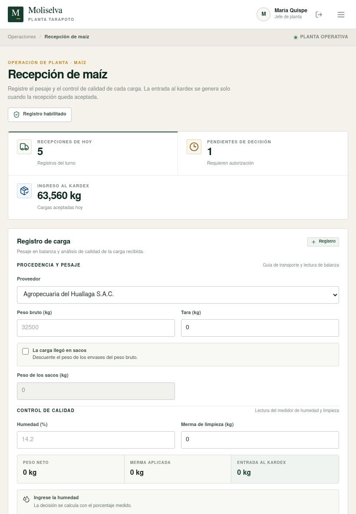

# Guía de pantallas · Moliselva

Documento de apoyo para la revisión del frontend de la Tarea 11. Las capturas corresponden a la aplicación conectada al backend local y a la base de datos de demostración.

## 1. Objetivo

Documentar el recorrido operativo de **PO-01 Recepción y acondicionamiento de maíz**: acceso por roles, registro y decisión de recepciones, y consulta del kardex. La interfaz se limita a tres pantallas para que el flujo pueda revisarse de punta a punta.

## 2. Mapa de navegación

```text
Acceso
  Recepción de maíz
    Registro de carga
    Recepciones del día
    Decisión de una recepción pendiente
  Kardex de maíz
    Stock y último movimiento
    Libro de movimientos
    Exportación CSV
```

Todas las rutas internas requieren sesión. El operario y el jefe de planta ingresan a Recepción; el administrador y la contadora ingresan a Kardex. Si un rol no puede ejecutar una acción, el control no se muestra y el backend rechaza la operación.

## 3. Pantallas

### 3.1 Acceso



- Marca Moliselva y contexto de la planta de Tarapoto.
- Formulario de usuario y contraseña, sin tarjetas de cuentas demo.
- El acceso queda asociado al usuario y la sesión se guarda en `sessionStorage`.
- Los errores de credenciales se informan dentro del formulario.
- La fotografía de campo es de Tomascastelazo (Wikimedia Commons, CC BY-SA 4.0).

### 3.2 Recepción de maíz



- Resume recepciones del día, pendientes de decisión e ingreso acumulado al kardex.
- El formulario separa procedencia y pesaje, control de calidad y confirmación.
- Calcula peso neto como peso bruto menos tara y peso de sacos.
- Calcula la entrada al kardex como peso neto menos merma de limpieza.
- La lectura de humedad se acompaña de una escala visual y del estado esperado.
- Humedad `<= 14.5%`: aceptación automática.
- Humedad `> 14.5%` y `<= 15%`: queda pendiente de decisión del jefe de planta.
- Humedad `> 15%`: rechazo, sin entrada al kardex.
- El botón de registro solo aparece para operario y jefe de planta.

### 3.3 Recepciones del día



- Bandeja con hora, proveedor, peso neto, humedad, merma, estado y decisión.
- Filtros por estado y contador de registros.
- La columna de responsable de registro se oculta si la API devuelve `registradoPor: null`.
- El jefe de planta ve el botón `Decidir` en las recepciones pendientes.
- El modal de decisión exige aceptar o rechazar y registrar un motivo.
- Una recepción aceptada genera una entrada al kardex; una rechazada no modifica el stock.

### 3.4 Kardex de maíz



- Stock actual del maíz en planta.
- Cantidad de movimientos del libro.
- Último movimiento con cantidad y fecha.
- Libro cronológico con fecha, tipo, documento de origen, cantidad, saldo y usuario.
- Las cantidades se muestran con signo y el saldo se calcula de forma acumulada.
- Exportación CSV para jefe de planta, contadora y administrador.
- El kardex es inmutable; las correcciones se registran como ajustes con motivo.

### 3.5 Adaptación móvil





- La navegación superior se convierte en un menú desplegable.
- Las tarjetas de resumen se apilan y el formulario pasa a una columna.
- En las tablas se oculta la columna de fecha y se muestran fecha, peso neto y merma dentro de la celda del proveedor.
- En el kardex, fecha, origen y usuario se muestran como detalle del movimiento.
- La página no presenta desbordamiento horizontal a 390 px.

### 3.6 Vista tablet



- A 820 px se mantiene el menú compacto y el formulario ocupa el ancho disponible.
- Los indicadores se reorganizan en dos columnas y las tablas conservan todas sus columnas.

## 4. Estados y mensajes

| Estado | Significado | Efecto en stock |
| --- | --- | --- |
| `ACEPTADA` | Humedad conforme o autorización del jefe | Genera entrada al kardex |
| `PENDIENTE` | Humedad entre 14.5% y 15% | No modifica el stock |
| `RECHAZADA` | Humedad mayor a 15% o decisión negativa | No modifica el stock |

Los estados vacíos, errores de carga y errores de validación se muestran dentro de la pantalla, sin bloquear la navegación.

## 5. Verificación visual

- Resolución de escritorio: 1440 × 1000.
- Resolución de tablet: 820 × 1180.
- Resolución móvil: 390 × 844.
- Las capturas se tomaron con el usuario `jefe_demo` y datos de la base local.
- No se registraron errores de consola durante el recorrido.
